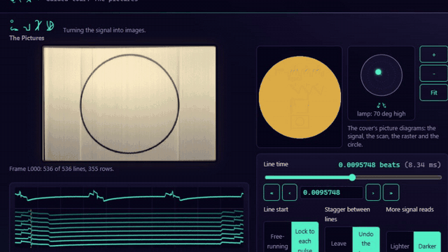
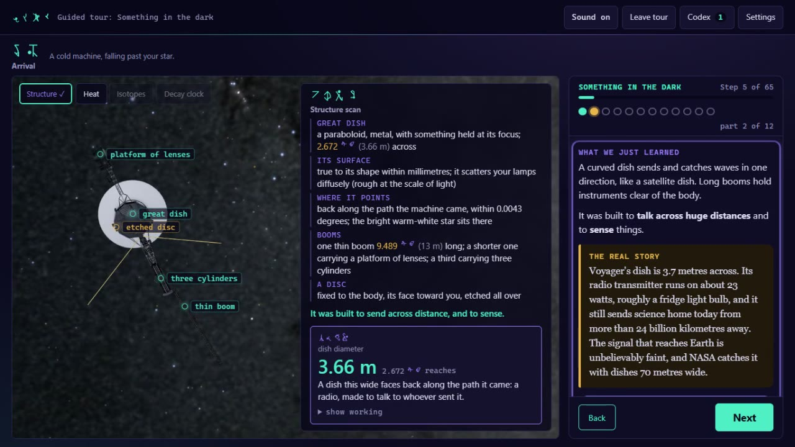
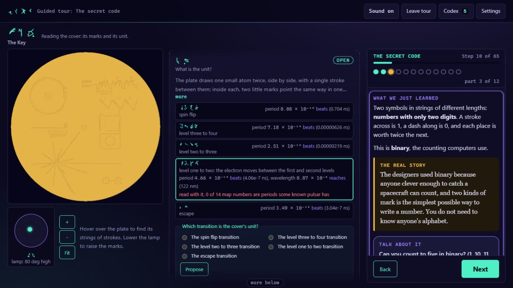
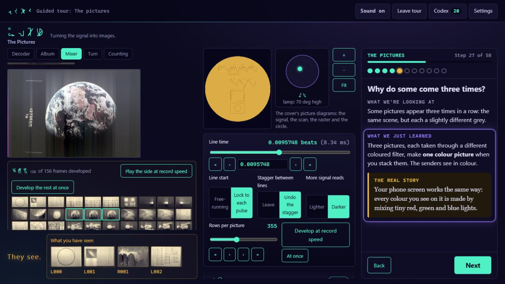
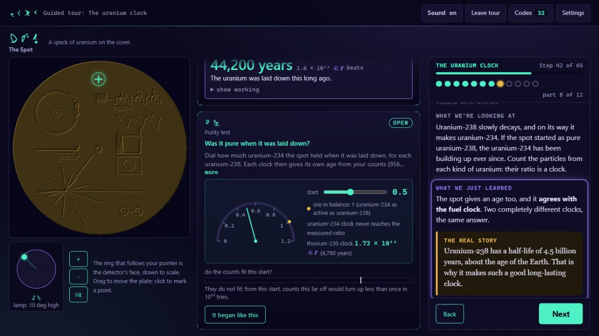
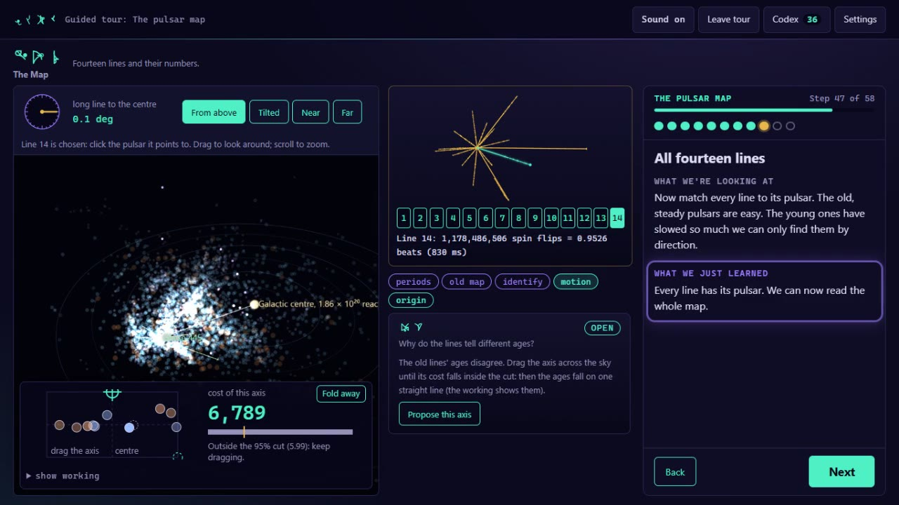
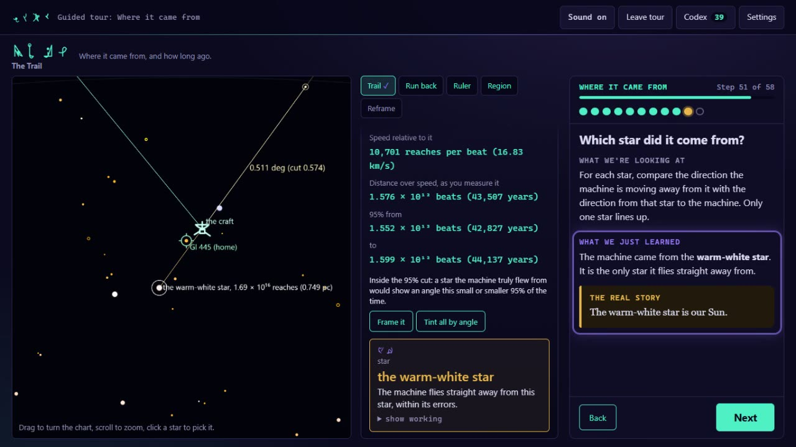

# The Finder


Play the alien who finds Voyager 1 and decodes the Golden Record from the cover alone, every deduction checked against real data.



**[Landing page](https://the-finder.pages.dev)** · **[Play the guided tour](https://the-finder.stewartgregerson.workers.dev/play/?tour=1)** · **[How it's checked](https://the-finder.stewartgregerson.workers.dev/checked/)**

## What it is

You are not human. About 44,000 years from now, a cold, tiny machine falls past your star: Voyager 1.
Starting from nothing but the object, you work out what it is, how old it is, how to play the gold record
it carries, what its pictures show, where it came from, when it left, and who sent it. Every answer is the
real one: the hydrogen key, the pulsar map, three radioactive clocks that have to agree, and the pictures
decoded line by line from the record's real 1977 image tape, right in your browser. You work on the
instruments (drag a map line onto a pulsar, sweep a detector, pick a star), every answer is judged by the
real science, and a wrong answer shows what it would really mean. A guided tour walks you through all 44
deductions in order, with "Do it for me" on every step; free play leaves you on your own.

**Where it stands (2026-10-22):** the V1.0 draft. All ten chapters are playable, from Arrival to Our Frame
(Arrival, The Key, The Player, The Pictures, The Voices, The Map, The Spot, The Trail, Portrait, Our Frame), and
the guided tour has 65 stops. Polish (M7) is under way: the tour now opens beside the spacecraft, each step
dims everything but the control it needs, and results lead with our own units. Best in desktop Chrome or Edge,
with headphones.
`PROGRESS.md` says exactly where the build is; `PLAN.md` is the roadmap.

## Screenshots

| | |
|---|---|
|  |  |
|  |  |
|  |  |

## How it's checked

Nothing the player sees is typed in by hand. Every number comes from `data/` (built by scripts from cited
sources, each download checksummed) or from `src/science/` computing on it. Every deduction has an
automated test against independent data, with error bars that are computed, never chosen, and the results
page is generated from the test output so it cannot drift from the code:
https://the-finder.stewartgregerson.workers.dev/checked/ (the same text is in `docs/HOW_ITS_CHECKED.md`).
What was decided and why is in `docs/DECISIONS.md`.

## How it was made

- **Stack:** TypeScript, Vite, three.js on WebGL2, Preact, Web Audio and Web Workers, served from
  Cloudflare Workers. Python for the reference tools and data builders.
- **Ground truth first:** a reference decoder in Python found all 156 picture frames on the 1977 tape from
  the signal alone; the browser decoder (in a Worker) matches it pixel for pixel. Pulsar, star and
  ephemeris data are built by scripts from ATNF, Jodrell Bank, HYG, Gaia DR3 and JPL Horizons.
- **Pure science code:** `src/science/` and `src/dsp/` never touch the page, so the same functions run in
  the browser and under Vitest in Node. Measurement noise comes from seeded streams, so a seed always
  gives the same game.
- **Played by bots:** the interface and the bots issue the same commands on one bus. Bots play every
  deduction from a fresh save and try dozens of wrong answers; science auditors and a blind player-critic
  review each milestone.
- **Media by script:** the landing page clips are filmed by `tools/showcase/film.mjs`, which drives the
  guided tour on the production build through the guide's own buttons and records a DevTools screencast.

Built with Claude Code, directed by Stewart Gregerson.

## Run it locally

```
npm install
npm run dev
```

Then open the address Vite prints and go to `/play/`. `npm run build` builds the site into `dist/`;
`npm run check` runs every test and check. The runtime media is committed; the large raw sources (the
1.46 GB image tape and the record's lossless audio) are only needed to rebuild it, and
`node tools/fetch-sources.mjs` fetches and verifies them. The landing page is `site/`, built with
`node tools/showcase/build-site.mjs`.

## Credits

The full list, one line per source with dates and checksums, is in [docs/CREDITS.md](docs/CREDITS.md).

| What | Who | Licence |
|---|---|---|
| Golden Record image tape (1977 Colorado Video master, transferred by Ozma Records, via the Internet Archive) | NASA/JPL and the record committee chaired by Carl Sagan; Ozma Records | Rights rest with their owners; credited here, not covered by MIT |
| Golden Record audio (40th Anniversary Edition remaster) | Ozma Records (2017) and the performers listed in CREDITS.md | Rights rest with their owners; credited here, not covered by MIT |
| Voyager 3D model | NASA Visualization Technology Applications and Development | NASA media guidelines |
| Golden Record cover photo GPN-2000-001978 | NASA/JPL | Public domain |
| Pioneer plaque vector drawing | Mysid, via Wikimedia Commons | Public domain |
| Milky Way colour map (Gaia EDR3) | ESA/Gaia/DPAC, A. Moitinho | CC BY-SA 3.0 IGO |
| ATNF Pulsar Catalogue v2.9.0 | Manchester, Hobbs, Teoh and Hobbs (2005), CSIRO | Free use with citation |
| Pulsar glitch catalogue, Crab ephemeris | Jodrell Bank Centre for Astrophysics | Free use with citation |
| HYG Stellar Database v4.2 | David Nash (astronexus) | CC BY-SA 4.0 |
| Gaia DR3 | ESA/Gaia/DPAC | Free use with acknowledgement |
| JPL Horizons ephemerides | NASA/JPL Solar System Dynamics | Public US government data |
| Fraunces and IBM Plex fonts (landing page) | Undercase Type; IBM, via Google Fonts | SIL OFL 1.1 |

Prior decoders we learned from (no code copied): Ron Barry, aizquier, Malte Gruber, Marc Baeuerle,
gourneau, Trammell Hudson; Robert Johnston's pulsar-map analysis.

## Licence

Code is MIT (see [LICENSE](LICENSE)). Third-party assets and data listed above keep their own licences.
